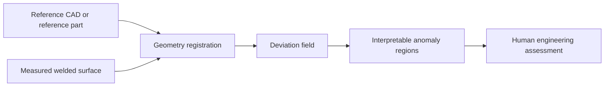

# Scientific problem statement (retrospective reconstruction, 2026)

Traditional weld inspection is supported—but not replaced—by optical 3D measurement. The target research question is whether a registered comparison of a welded test surface against a reference can reveal local surface-geometry nonconformities reproducibly.

## Conceptual method

## Primary hypothesis
After reference and sample geometries are consistently aligned, localized differences in the spatial distance field may indicate a subset of surface weld anomalies.

## Validity limits
- This is a surface-geometry hypothesis, not an inspection method for internal defects.
- Registration error, roughness, occlusion, scanner resolution and threshold choice alter interpretation.
- No ISO acceptance classification follows automatically from an anomaly score.

## Provenance
Retrospective synthesis based on P01; the original date of this problem statement is not established.
