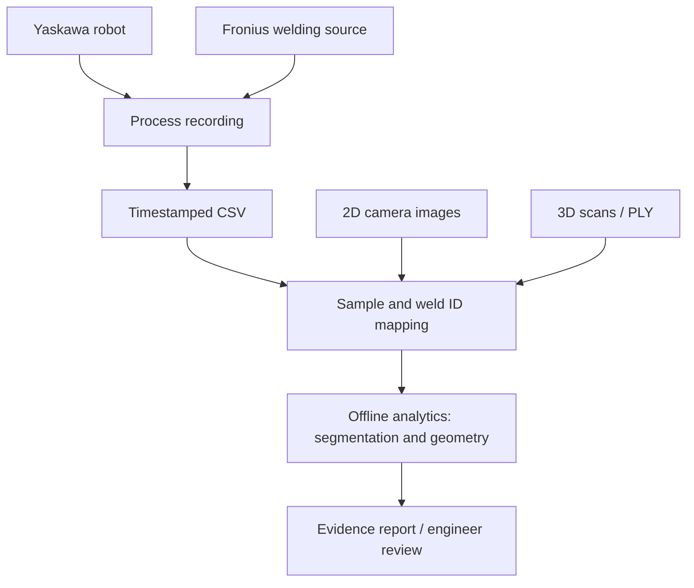

# TRL2 conceptual system architecture

**Status:** retrospective architecture of proposed subsystems; **not** a verified integrated deployment.

## Boundaries
- Physical cell and process recorder are separate from offline analytics and image/scanner acquisition.
- Joined records must preserve sample ID, weld number, process configuration, and timestamp where available.
- Existing images/PLYs may not be weld-specific; sample-level matching **must not** be presented as weld-level pairing.
- No closed-loop optimization, production approval, or real-time geometry decision is demonstrated by this architecture.
