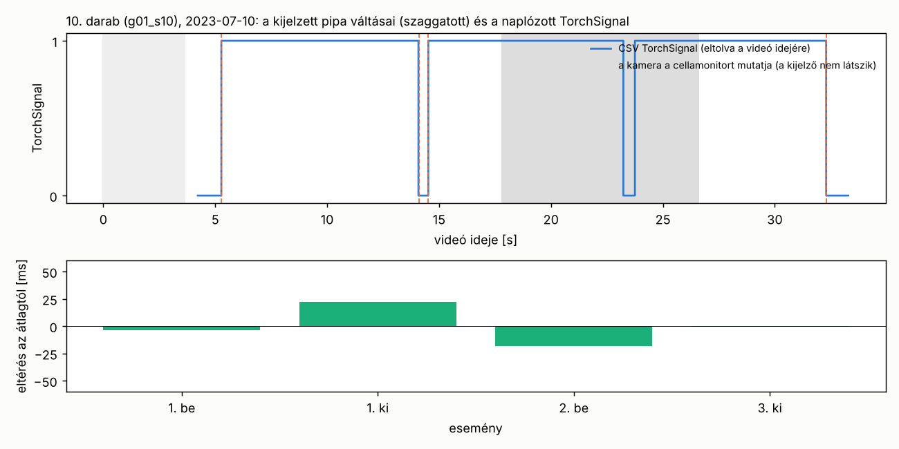

# T5-08 kiegészítő mérés – cellás videó, 10. darab (g01_s10)

**Bizonyítékosztály:** a felvétel valós, cellában készült (2023-07-10); a kiértékelés a nyers videóból és a nyers CSV-ből újraszámolt (B). A kiértékelés dátuma: 2026-10-30.

## Forrás

| Tétel | Érték |
| --- | --- |
| Videó | `10_darab.mp4` (telefonfelvétel, 1920×1080, kb. 30 fps, 40,5 s) |
| SHA-256 | `24c322d49d1b8110c211b421bc9d9c07c003ecb7d64891e0df5ba0921ae1412d` |
| Felvétel ideje | 2023-07-10, kb. 09:41 helyi idő (a fájl metaadata, a laptop órája és a naplófájl neve egyezik) |
| Párosított CSV | `datasets/welding_experiments_v1/g01_30/g01_s10.csv` (első sor 07:41:12,890 UTC = 09:41:12,890 helyi) |
| A képernyőn | RobotVis, a naplófájl neve `9_2023-07-10_9-41-12.csv`, Log File Prefix 10, Status: Connected; mellette a paramétertáblázat 10. sora: 96 A, 19,8 V, 30 cm/min, 3,0 m/min |

A videón a robotot és a kijelzőt nem egy képen vették fel (a kamera 17,8–26,6 s között a cellamonitort mutatja), ezért a robotvezérlő és az áramforrás felőli késés ebből nem mérhető.

## Módszer

1. A kijelzőn a „Torch Signal” pipa megjelenésének és eltűnésének első képkockáját kerestük meg (képkockánként, kb. 33 ms felbontás).
2. Ezeket a CSV TorchSignal-váltásainak idejéhez rendeltük. Az eltolás = videóidő − CSV-idő (a CSV első sorától számítva).
3. A kijelzett feszültség-, áram- és huzalsebesség-értékek sorrendje a váltások körül megegyezik a CSV soraival (például 19,8 V/95,5 A → 0,5 m/min → 19,47 V/15,2 A → 16,78 V/106,9 A).

## Eredmény

| Esemény | CSV-sor | CSV-idő [s] | Videó, első képkocka [s] | Eltolás [s] |
| --- | --- | --- | --- | --- |
| 1. varrat be | 43 | 1,054 | 5,270 | 4,216 |
| 1. varrat ki | 413 | 9,858 | 14,100 | 4,242 |
| 2. varrat be | 427 | 10,298 | 14,499 | 4,201 |
| 3. varrat ki | 1167 | 28,074 | 32,293 | 4,219 |

- **Stabilitás:** az eltolás 27 s alatt 4,201–4,242 s között marad (terjedelem 41 ms, kb. egy képkocka és a CSV kb. 110 ms-os mintavétele alatt). Késés-felhalmozódás vagy kijelzési megállás a látható szakaszokban nincs.
- **A késés felső becslése:** a naplófájl új neve a videó 3,637 s-ánál jelenik meg; a fájlnév szerint a fájl 09:41:12 és 09:41:12,890 között jött létre (az első CSV-sor ideje). Ebből a CSV-időbélyegtől a kijelzésig tartó késés **legfeljebb kb. 0,6–0,7 s** (a fájlnév másodperc-felbontása és a képkocka-kvantálás miatt alsó becslés nem adható).
- **Feltétel:** a becslés feltételezi, hogy a CSV `SysTimeMsecs` és a naplófájl neve ugyanabból az órából származik (az egyezés a másodpercig erre utal; a `SysTimeMsecs` forrása nyitott kérdés).

## Mit igazol és mit nem (a T5-08 kapuhoz)

- **Igazol (1 valós cellás futás):** a RobotVis valós hegesztés közben kapcsolódva, folyamatosan és a naplóval egyezően jelenít meg; a kijelzési késés felső becslése kb. 0,6–0,7 s, jóval a javasolt 2 s alatt; a késés a futás alatt állandó.
- **Nem igazol:** három futást (ehhez a `20_darab` és `30_darab` videó kiértékelése kell); P50/P95 eloszlást (4 esemény); az adatvesztés számát; a robotvezérlő és az áramforrás felőli késést; a nem fejlesztő kezelő önálló használatát.

