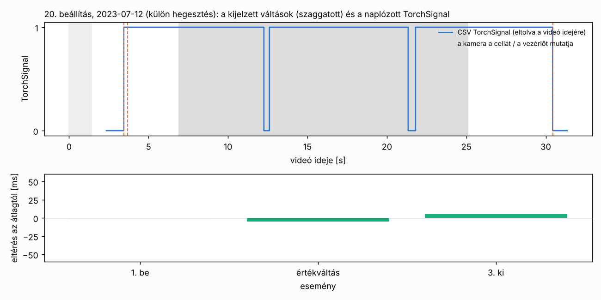

# T5-08 kiegészítő mérés – cellás videó, 20. beállítás, 2023-07-12

**Bizonyítékosztály:** a felvétel és a CSV valós, cellában készült (2023-07-12); a kiértékelés a nyers videóból és a nyers CSV-ből újraszámolt (B). A kiértékelés dátuma: 2026-10-30. A módszer azonos a 10. darab riportjáéval (`../video_10_darab/`).

**Fontos:** ez külön hegesztés a 20. sor beállításaival (160 A, 21,4 V, 30 cm/min, 5 m/min). A 150 darabos adatsorban lévő `g01_s20.csv` 2023-07-10-én készült, nem ehhez a videóhoz tartozik. A videóhoz tartozó naplót (`20_2023-07-12_14-42-8.csv`) ebben a mappában adjuk közre; a 150 darabos adatsorba nem kerül.

## Forrás

| Tétel | Érték |
| --- | --- |
| Videó | `20_darab.mp4` (telefonfelvétel, 1920×1080, kb. 30 fps, 33,2 s) |
| Videó SHA-256 | `b7bd9346073ab21adc3e4c492dd50a2ecc79ba6256bf8d1c8beb053805e9e059` |
| Napló | `20_2023-07-12_14-42-8.csv`, 1210 sor, SHA-256 `4496a330cef6114504502b438d90aeb205a73b4103e0880a43f333a4d1a14331` |
| Felvétel ideje | 2023-07-12, kb. 14:42 helyi idő; első CSV-sor 12:42:09,105 UTC = 14:42:09,105 helyi |
| A képernyőn | a naplófájl neve `150_2023-07-12_14-37-35.csv` → `20_2023-07-12_14-42-8.csv` (videó 1,411 s), Log File Prefix 20, Status: Connected |

A kamera 6,9–25,1 s között a cellamonitort (ív) és a vezérlőt mutatja; az 1. varrat vége, a 2. varrat és a 3. eleje ezért nem látszik.

## Eredmény

| Esemény | CSV-sor | CSV-idő [s] | Videó, első képkocka [s] | Eltolás [s] |
| --- | --- | --- | --- | --- |
| 1. varrat be | 43 | 1,098 | 3,444 | 2,346 |
| értékváltás (19,8 V/127,6 A/3,11 m/min) | 50 | 1,335 | 3,677 | 2,342 |
| 3. varrat ki | 1169 | 28,081 | 30,433 | 2,352 |

- **Stabilitás:** az eltolás 27 s alatt 2,342–2,352 s (terjedelem 10 ms). Késés-felhalmozódás vagy kijelzési megállás a látható szakaszokban nincs.
- **A késés felső becslése:** az új naplófájl neve a videó 1,411 s-ánál jelenik meg (1,378 s-nál még a régi); a fájl 14:42:08 és 14:42:08,999 között jött létre, az első sor 14:42:09,105-kor. Ebből a késés **legfeljebb kb. 0,86 s**.
- **Feltétel:** a CSV `SysTimeMsecs` és a naplófájl neve ugyanabból az órából származik (nyitott kérdés).

