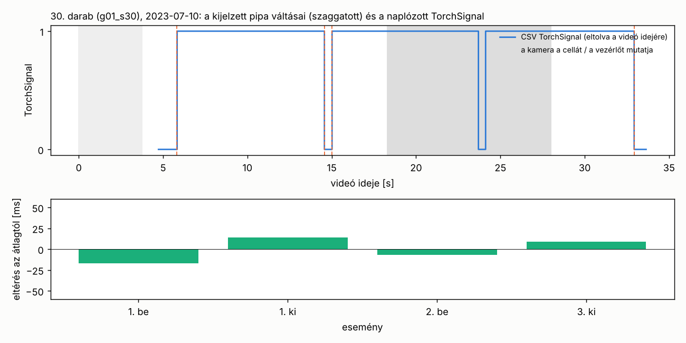

# T5-08 kiegészítő mérés – cellás videó, 30. darab (g01_s30)

**Bizonyítékosztály:** a felvétel valós, cellában készült (2023-07-10); a kiértékelés a nyers videóból és a nyers CSV-ből újraszámolt (B). A kiértékelés dátuma: 2026-10-30. A módszer azonos a 10. darab riportjáéval (`../video_10_darab/`).

## Forrás

| Tétel | Érték |
| --- | --- |
| Videó | `30_darab.mp4` (telefonfelvétel, 1920×1080, kb. 30 fps, 36,7 s) |
| SHA-256 | `b23ae9525094a55202c14d18c766363a92316ee9ba287d4f713bf9b63b200705` |
| Felvétel ideje | 2023-07-10, kb. 12:42 helyi idő (fájl-metaadat, a laptop órája és a naplófájl neve egyezik) |
| Párosított CSV | `datasets/welding_experiments_v1/g01_30/g01_s30.csv` (első sor 10:42:45,167 UTC = 12:42:45,167 helyi) |
| A képernyőn | RobotVis, a naplófájl neve a felvétel indításakor `29_2023-07-10_12-34-1.csv` → `30_2023-07-10_12-42-44.csv` (videó 3,749 s), Log File Prefix 30, Status: Connected; 23,8 V, 200 A, 7 m/min |

A kamera 18,3–28,0 s között a cellamonitort és a vezérlőt mutatja; a 2. varrat vége és a 3. eleje ezért nem látszik.

## Eredmény

| Esemény | CSV-sor | CSV-idő [s] | Videó, első képkocka [s] | Eltolás [s] |
| --- | --- | --- | --- | --- |
| 1. varrat be | 42 | 1,107 | 5,815 | 4,708 |
| 1. varrat ki | 408 | 9,839 | 14,578 | 4,739 |
| 2. varrat be | 424 | 10,293 | 15,011 | 4,718 |
| 3. varrat ki | 1168 | 28,204 | 32,938 | 4,734 |

- **Stabilitás:** az eltolás 27 s alatt 4,708–4,739 s (terjedelem 31 ms, kb. egy képkocka). Késés-felhalmozódás vagy kijelzési megállás a látható szakaszokban nincs; a kijelzett értékek a CSV soraival egyeznek (például 23,8 V/200 A → 12,97 V/0,1 A/0,29 m/min az ívgyújtáskor; a végén 23,42 V/211,7 A).
- **A késés felső becslése:** az új naplófájl neve a videó 3,749 s-ánál jelenik meg (előtte 3,716 s-nál még a régi név); a fájl 12:42:44 és 12:42:44,999 között jött létre, az első CSV-sor 12:42:45,167-kor. Ebből a CSV-időbélyegtől a kijelzésig tartó késés **legfeljebb kb. 0,85 s**.
- **Feltétel:** a CSV `SysTimeMsecs` és a naplófájl neve ugyanabból az órából származik (nyitott kérdés).

## Mit igazol és mit nem

- **Igazol (1 valós cellás futás):** folyamatos, a naplóval egyező megjelenítés valós hegesztés közben; a késés felső becslése kb. 0,85 s, a javasolt 2 s alatt; a késés a futás alatt állandó.
- **Nem igazol:** P50/P95 eloszlást, adatvesztést, a robotvezérlő és az áramforrás felőli késést, a nem fejlesztő kezelő önálló használatát.

